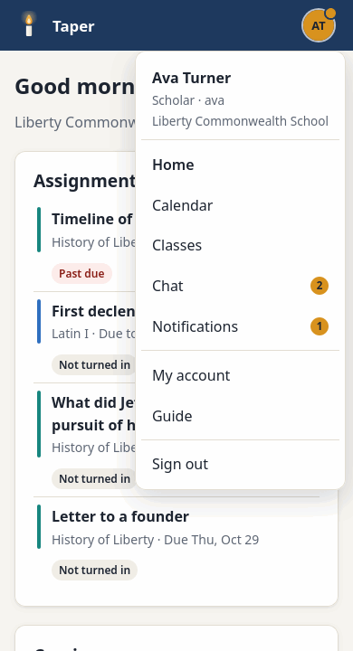
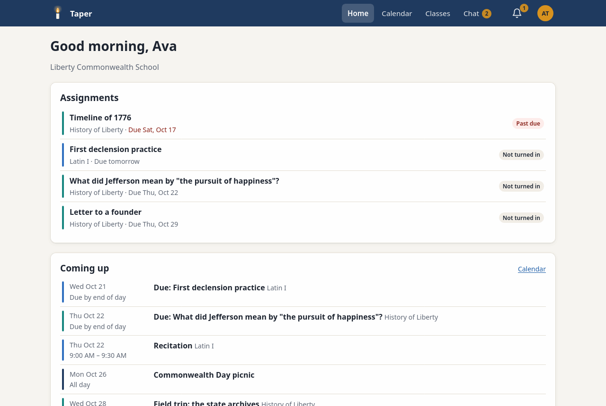

# Getting started

## Signing in for the first time

Your school gives you three things: Taper's web address, your **username**, and
a **temporary password**.

1. Open the address in a web browser. Any current browser works: Safari, Chrome,
   Edge or Firefox, on a phone, tablet or computer.
2. Enter your username and temporary password, then select **Sign in**.
3. Choose your own password. Use at least 8 characters. A short sentence is easy
   to remember and hard to guess.

**Keep me signed in on this device** keeps you signed in for 30 days after you
last used Taper. Leave it off on a shared or school computer. Then you're signed
out after 12 hours, or when the browser is closed.

## Who can do what

Everyone at the school has one of five roles:

| Role | Who | What they can do |
|------|-----|------------------|
| **Scholar** | Students | See their classes and calendar, work on and turn in assignments, read Community, and chat with their classes and group chats |
| **Parent** | Parents and guardians | Follow their scholars' classes, calendars and work; write and turn in work for them; read Community and talk in their scholars' class chats |
| **Mentor** | Teachers | Everything scholars can do, plus run their classes: post assignments, give feedback, add class events and look after class chat |
| **Board** | The school's board | See and run every class, calendar, assignment and chat; post in Community; make group chats; manage mentors, parents and scholars |
| **Admin** | School leaders | Everything the board can do, plus manage admin and board accounts, and the server: settings, updates, network, email and backups |

Mentors, board members and admins can be parents too: an admin or the board
links any of them to their children, and they see the same things a parent does.

Taper doesn't use letter grades. In the TJEd way, mentors give written feedback
on scholars' work.

## Forgot your password?

If your school has set up email and your account has an email address, use
**Forgot your password?** on the sign-in page. Otherwise, ask a mentor or admin
at your school. An admin can create a new temporary password for you (see
[Managing people](people.md)).

## Getting around

Along the top:

- **Home** shows your assignments across all your classes, what's coming up,
  and your classes.
- **Calendar** shows the school calendar and your classes' calendars.
- **Classes** lists your classes, and for mentors and admins, every class.
  Each class's page has its assignments.
- **Chat** has the community chat and your class chats. The number shows
  messages you haven't read.

Your initials, at the far right, open your menu:

- **My account:** your name, email, password and two-step sign-in.
- **Guide:** this guide.
- **Settings** (admins): the school's settings, people, updates, network and
  email, as tabs across the top of the page.
- **Sign out** when you're done.

On a phone, the top bar shows only your initials. They open one menu with
Home, Calendar, Classes, Chat and Notifications as well as your own links. A
dot on your initials means there's something new.
